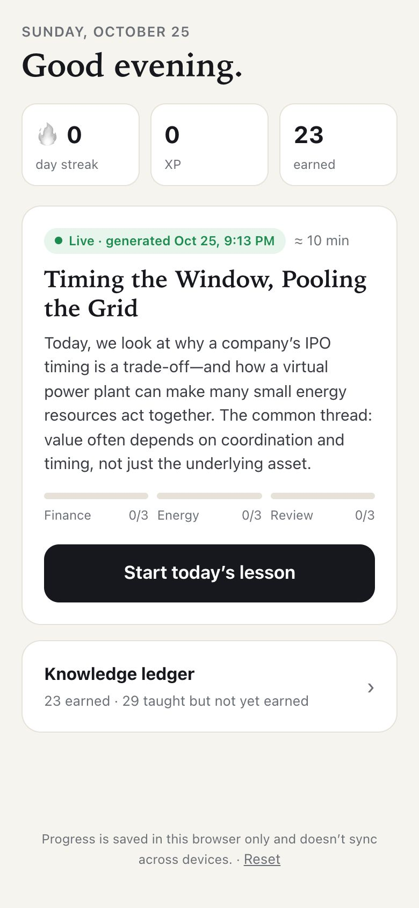
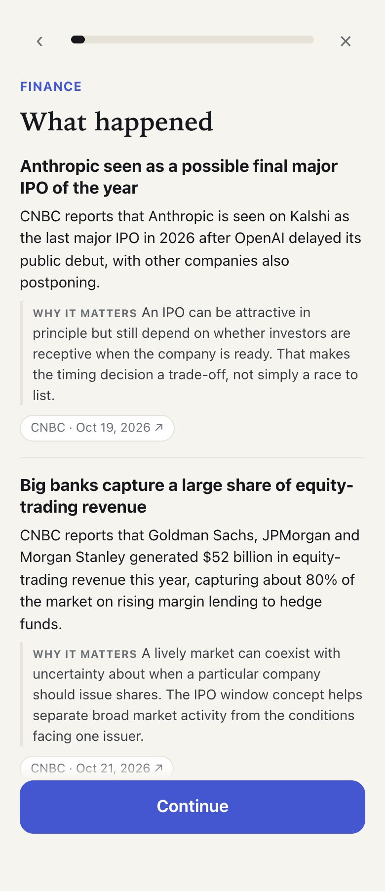
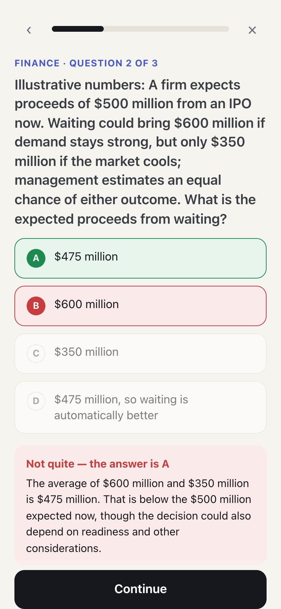
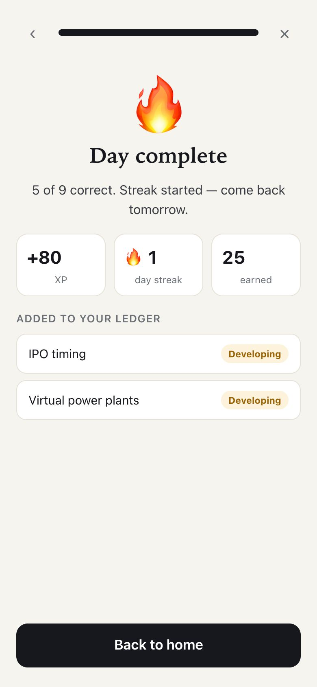

# Daily Signal — Climate + Finance

**A mobile-first, ~10-minute daily lesson.** An AI agent reads today's public finance and energy news, picks one concept per domain that the news makes intuitive, and writes a short lesson with tap-to-answer quizzes. A code-enforced knowledge ledger remembers only what you've actually *earned* by completing a quiz, and spaced review draws only from that ledger.

MGT 409 (AI Foundations for Managers) final project · David Wingate · Yale SOM · Repo: [https://github.com/dw565/daily-signal](https://github.com/dw565/daily-signal)

<p>
  
  
  
  
</p>

## Run it (about 3 minutes)

Requires **Node.js 20+** (`node -v`). No database, no login, no other services.

1. **API key.** Put a `.env` containing `PORTKEY_API_KEY=...` (course key, model `gpt-6-luna`) or `OPENAI_API_KEY=...` in **this repo folder or the folder above it**. The app checks the repo folder first, then the parent. See [`.env.example`](.env.example).
2. **Install and start:**
   ```bash
   npm install
   npm run dev
   ```
3. **Open http://localhost:3409.** For the intended layout, use your browser's phone view (DevTools → device toolbar), or open `http://<your-computer's-IP>:3409` on a phone on the same Wi-Fi.

The first visit each day builds a **live** lesson from current news (about 20–30 seconds, shown with a progress card). After that it's cached for the day: refreshing costs no tokens.

### Live vs sample mode
| Mode | When | Label in the app |
|---|---|---|
| **Live** | An API key is found | Green “Live · generated …” badge, plus a “How this lesson was made” line (model, feeds, tokens, cost) |
| **Sample** | No key, `?demo` in the URL, `DAILY_SIGNAL_MODE=demo`, or a failed live run | Amber “Sample lesson · news from Oct 15–23, 2026” badge. A bundled lesson built from real, dated public news |

If live generation fails (bad key, network down), the app shows the real error with **Try again** and **Use sample lesson** buttons. It never passes off the sample as live.

**To start over:** tap **Reset** at the bottom of the home screen (erases progress in this browser only).

## What to try (2 minutes)
1. Start today's lesson → read the news (each item links to its source) → the concept → the worked example.
2. Answer the finance quiz. Get one wrong on purpose and see the feedback.
3. Refresh mid-quiz: you resume in place, and your locked answers stay.
4. Finish energy + review → the day completes and XP and streak are credited once.
5. Open **Knowledge ledger**: today's two concepts moved from “Not yet earned” to “Earned”.

## Tests and evidence
```bash
npm test                 # 41 unit tests, no API calls: ledger invariants, agent validation, prompt-injection defense
npm run check:secrets    # scans tracked files, client bundle, traces, logs for .env secret values
npm run test:live        # real model + feeds: benchmark, red team, cache experiment, bad key (spends ~$0.02)
npm run tokenomics       # cost per run / user / month from the recorded runs
```
Recorded runs are in [`evidence/`](evidence/README.md). The submission documents are [`report.html`](report.html) and [`slides.html`](slides.html), rebuilt with `npm run docs`.

## How it works
1. **Retrieve** (tool): 6 public RSS feeds (CNBC, Federal Reserve, BBC Business, U.S. EIA, Utility Dive, Canary Media), with timeouts, size caps and sanitized text.
2. **Screen** (code): quarantines feed items that try to instruct the AI or the app.
3. **Curate + write** (LLM): one `gpt-6-luna` call with a strict JSON schema. It sees the learner's earned and pending concept IDs, and today's news sits in its own cached prompt block.
4. **Validate** (code): citations must be retrieved sources, numbers must appear in the cited source, and already-earned concepts are rejected; one corrective retry.
5. **Ledger** (code, on the phone): deterministic grading; a concept is earned only when its quiz is complete; review comes only from earned concepts; XP and streak are credited once.

Key files: `src/lib/ledger.ts` (learning rules), `src/server/generate.ts` (agent run), `src/server/sources.ts` (retrieval + screen), `src/server/prompt.ts`, `src/app/api/lesson/route.ts` (caching, rate limits).

## Configuration
| Variable | Required | Purpose |
|---|---|---|
| `PORTKEY_API_KEY` | one of these two | Course key via Portkey (`https://api.portkey.ai/v1`); used first |
| `OPENAI_API_KEY` | one of these two | Personal OpenAI key; used if no Portkey key |
| `DAILY_SIGNAL_MODEL` | no | Model override (default `gpt-6-luna`) |
| `DAILY_SIGNAL_MODE` | no | `demo` forces sample mode (no model calls) |
| `DAILY_SIGNAL_MAX_RUNS_PER_DAY` | no | Server-wide generation cap (default 40) |

## Limitations
- Progress is stored in **this browser only** (`localStorage`, versioned and schema-validated). It does **not** sync across devices.
- Not deployed online; runs locally.
- Pilot evidence is a single user (the author). Lesson quality is checked structurally (schema, citations, numbers), not by a formal pedagogy evaluation.
- No novelty steering yet beyond “never re-teach an earned concept”, so same-day runs often pick similar concepts.
- Not built: free-response reflections, the Friday weekly review, push reminders, newsletter (Gmail) ingestion.
